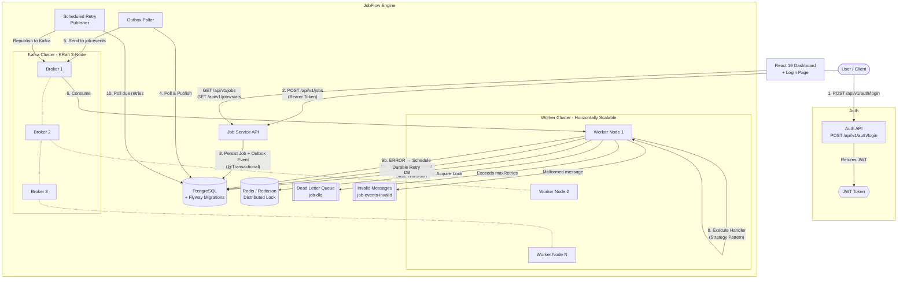
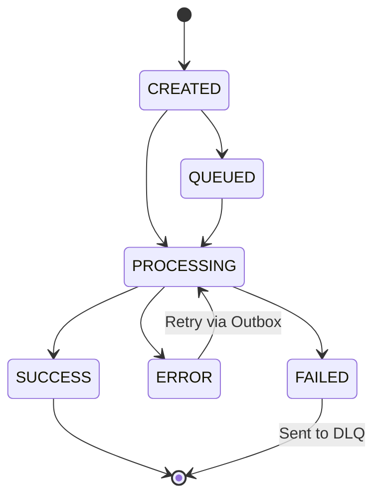

# JobFlow

JobFlow is a distributed, asynchronous job processing engine built with Spring Boot, Kafka, and Redis, designed to execute background tasks reliably.

## 🎯 The Problem
In modern distributed systems, directly processing heavy tasks (like PDF generation, massive report aggregation, or bulk emails) within a synchronous HTTP request blocks the main thread, causing application timeouts and poor user experience. Additionally, simple background threads are volatile — if a node crashes, the task is lost forever.

## 💡 The Solution
JobFlow solves this by decoupling job ingestion from job processing using an event-driven architecture.
1. The **Job Service** quickly persists the job request and acknowledges the user.
2. An event is published to **Kafka** via the Transactional Outbox pattern.
3. A cluster of **Job Workers** pull jobs from Kafka and process them safely in the background.

## 🏗️ Architecture



### Job State Machine


## 🛠️ Tech Stack
- **Backend**: Java 25, Spring Boot 4.1.1
- **Database**: PostgreSQL 15 (State, Idempotency & Outbox)
- **Schema Management**: Flyway (versioned SQL migrations)
- **Message Broker**: Apache Kafka 3.7, 3-node KRaft cluster (no Zookeeper) with combined broker+controller roles
- **Distributed Locking**: Redis 7 + Redisson 3.43 (RLock with watchdog auto-renewal)
- **Authentication**: JWT (jjwt 0.12.3) with role-based access control (USER / ADMIN)
- **Frontend**: React 19, Vite 8, Lucide Icons, React Router 7
- **Observability**: Spring Boot Actuator (liveness & readiness probes)
- **Infrastructure**: Docker & Docker Compose *(Note: This repository provides a distributed worker/Kafka topology for portfolio demonstration. For true production high availability, PostgreSQL and Redis would require managed cluster deployments.)*

## 🔐 Authentication & Authorization

JobFlow secures all API endpoints with **JWT-based authentication** and **role-based access control (RBAC)**.

### Roles
| Role | Permissions |
|---|---|
| `USER` | Create jobs, view own jobs |
| `ADMIN` | Create jobs, view all jobs, access dashboard stats |

### Login Flow
1. Client sends credentials to `POST /api/v1/auth/login`.
2. Server returns a signed JWT token.
3. All subsequent requests include the token as `Authorization: Bearer <token>`.
4. The `JwtFilter` validates the token on every request and sets the security context.

Credentials are configured via environment variables (see [Environment Setup](#-environment-setup)).

## 📡 API Documentation

> **Note:** All endpoints except `/api/v1/auth/**` require a valid JWT Bearer token.

### Authenticate
`POST /api/v1/auth/login`
```json
{
  "username": "user",
  "password": "your_password"
}
```
**Response:**
```json
{
  "token": "eyJhbGciOiJIUzI1NiIs..."
}
```

### Create Job
`POST /api/v1/jobs`

**Headers:** `Authorization: Bearer <token>`
```json
{
  "type": "PDF_GENERATION",
  "payload": {
    "userId": "123",
    "template": "invoice"
  },
  "priority": 5,
  "maxRetries": 3
}
```

**Supported Job Types:**
| Type | Handler | Simulated Duration |
|---|---|---|
| `PDF_GENERATION` | `PdfJobHandler` | ~3s |
| `EMAIL` | `EmailJobHandler` | ~1.5s |
| `REPORT` | `ReportJobHandler` | ~5s |

### Get Job Status
`GET /api/v1/jobs/{jobId}`

**Headers:** `Authorization: Bearer <token>`

*Users can only view their own jobs. Admins can view all jobs.*

### List All Jobs (Paginated)
`GET /api/v1/jobs?page=0&size=20&sort=createdAt,desc`

**Headers:** `Authorization: Bearer <token>`

*Users see only their own jobs. Admins see all jobs.*

### Get Dashboard Stats
`GET /api/v1/jobs/stats`

**Headers:** `Authorization: Bearer <token>`

*Requires `ADMIN` role.*

**Response:**
```json
{
  "total": 150,
  "queued": 10,
  "processing": 5,
  "successful": 120,
  "failed": 8,
  "dlq": 7
}
```

## 🛡️ Reliability Engineering

### 1. Kafka Design (3-Node KRaft Cluster)
Kafka acts as the central nervous system, running as a **3-node KRaft cluster** with combined broker+controller roles — eliminating the Zookeeper dependency. Topics are configured with replication factor 3 and `min.insync.replicas=2` for durability. By using Consumer Groups, JobFlow naturally load balances tasks across the worker cluster. If a worker goes down, Kafka automatically rebalances the partition to healthy nodes.

### 2. Transactional Outbox Pattern
To solve the classic DB-to-Kafka dual-write problem, the Job Service uses the **Transactional Outbox Pattern**. Instead of publishing to Kafka directly after saving to the database (which could strand jobs if the app crashes between the DB commit and Kafka publish), the API transactionally writes an `outbox_event` to the database alongside the job. A background `OutboxPublisher` poller then reliably sweeps the outbox and publishes the events to Kafka, guaranteeing at-least-once publishing without data loss.

### 3. Exponential Backoff Retry Strategy & Durable Retry Outbox
If a job throws an exception, the worker catches it and calculates an exponential backoff (1s → 2s → 4s). However, rather than scheduling the retry in volatile JVM memory (which would be lost if the worker crashed), it writes a `scheduled_retries` entry into PostgreSQL **transactionally** alongside the job's `ERROR` state. A background `ScheduledRetryPublisher` sweeps the database and reliably pushes due retries back to the Kafka topic. This prevents hammering failing third-party APIs while persisting retry schedules in PostgreSQL so retries survive worker process failures.

### 4. State Idempotency
Because Kafka guarantees at-least-once delivery, duplicates can occur. We enforce *state idempotency* by leveraging JPA Optimistic Locking (`@Version`) on the job state and atomic state transitions in PostgreSQL. Optimistic locking and terminal-state checks prevent duplicate job state progression when multiple workers receive the same job. *(Note: While this protects the internal job state, true business-operation idempotency would require passing a unique idempotency key to downstream external services.)*

### 5. Redis Distributed Locking (Redisson)
To prevent edge cases where two workers might receive identical events simultaneously, workers must acquire a distributed lock before processing. We use **Redisson** for this, which provides a mature locking abstraction (`RLock`). Redisson automatically manages lease renewals (the "watchdog" pattern) for long-running jobs and safely ties the lock to the specific worker thread. If a lock is currently held by another node (e.g. during a partition rebalance), the worker will safely wait to acquire it before proceeding, guaranteeing that duplicate messages do not cause race conditions or premature offset commits.

### 6. Dead Letter Queue (DLQ) & Invalid Message Routing
When a job exceeds its `maxRetries`, it is marked as `FAILED` and published to a special `job-dlq` Kafka topic for manual engineering intervention. Additionally, malformed or unparseable messages are routed to a `job-events-invalid` topic, and events with no registered handler are routed to `job-events-dlq`, ensuring the main consumer is never blocked by poison pills.

### 7. Strategy Pattern for Extensible Task Processing
The worker engine employs the **Strategy Pattern** via a flexible `JobHandler` interface. Instead of hardcoding task logic, developers can create distinct job handlers (`PdfJobHandler`, `EmailJobHandler`, `ReportJobHandler`, etc.) that the worker dynamically selects based on the event payload. Adding a new job type requires only implementing the `JobHandler` interface and annotating with `@Component` — zero changes to the consumer or routing logic.

### 8. Synchronous Offsets & Consumer Concurrency
To guarantee zero message loss, the worker processes each task synchronously within the `KafkaListener` thread. This prevents Spring Kafka from committing the consumer offset until the task is definitively completed or securely scheduled for a durable retry. We achieve high throughput and horizontal scalability by running multiple worker replicas and increasing the Kafka topic's partition count, allowing the consumer group to naturally balance the load across the cluster.

### 9. Long-Running Jobs & Consumer Stability
Because Kafka requires consumers to poll periodically, long-running jobs (e.g., executing for 20+ minutes) can trigger a consumer rebalance if they exceed the maximum poll interval. JobFlow explicitly configures `max.poll.interval.ms` to 1 hour (3,600,000 ms) to support expected maximum processing durations without creating unnecessary consumer-group instability.

### 10. Schema Evolution with Flyway
Database schema is managed through **Flyway** versioned SQL migrations, ensuring reproducible, auditable schema changes across all environments. Hibernate is configured with `ddl-auto: validate` (service) / `ddl-auto: none` (worker) to guarantee the schema always matches what Flyway has applied — preventing accidental drift.

## 🚀 How to Run

JobFlow is packaged for startup using Docker Compose.

### 1. Environment Setup
Copy the example environment file and configure your secrets:
```bash
cp .env.example .env
```

Edit `.env` with your values:
```env
# Database
DB_PASSWORD=your_secure_password_here

# Authentication Credentials
JOBFLOW_AUTH_USER_PASSWORD=secure_user_password
JOBFLOW_AUTH_ADMIN_PASSWORD=secure_admin_password

# JWT Settings (secret must be Base64-encoded, at least 256 bits)
JOBFLOW_JWT_SECRET=your_base64_encoded_secure_jwt_secret_here
JOBFLOW_JWT_EXPIRATION_MS=36000000
```

### 2. Start the Infrastructure
Ensure Docker is running, then spin up all services:
```bash
docker-compose up -d --build
```

This starts: PostgreSQL, 3-node Kafka cluster, Redis, Job Service, Job Worker, and the React frontend.

### 3. Access the Dashboard
Open the UI to log in and monitor jobs:
- [http://localhost:5173](http://localhost:5173)

Log in with the credentials you configured in `.env`.

### 4. Scale Workers on the Fly
```bash
docker-compose up -d --scale job-worker=3
```

### 5. Quick API Test
```bash
# Login
TOKEN=$(curl -s -X POST http://localhost:8080/api/v1/auth/login \
  -H "Content-Type: application/json" \
  -d '{"username":"user","password":"your_password"}' | jq -r '.token')

# Create a job
curl -X POST http://localhost:8080/api/v1/jobs \
  -H "Content-Type: application/json" \
  -H "Authorization: Bearer $TOKEN" \
  -d '{"type":"PDF_GENERATION","payload":{"template":"invoice"},"maxRetries":3}'

# Check job status
curl -H "Authorization: Bearer $TOKEN" http://localhost:8080/api/v1/jobs/{jobId}
```

## 🎥 Demo
Check out the fully functional dashboard in action, monitoring 100+ async jobs seamlessly recovering from errors and scaling!


