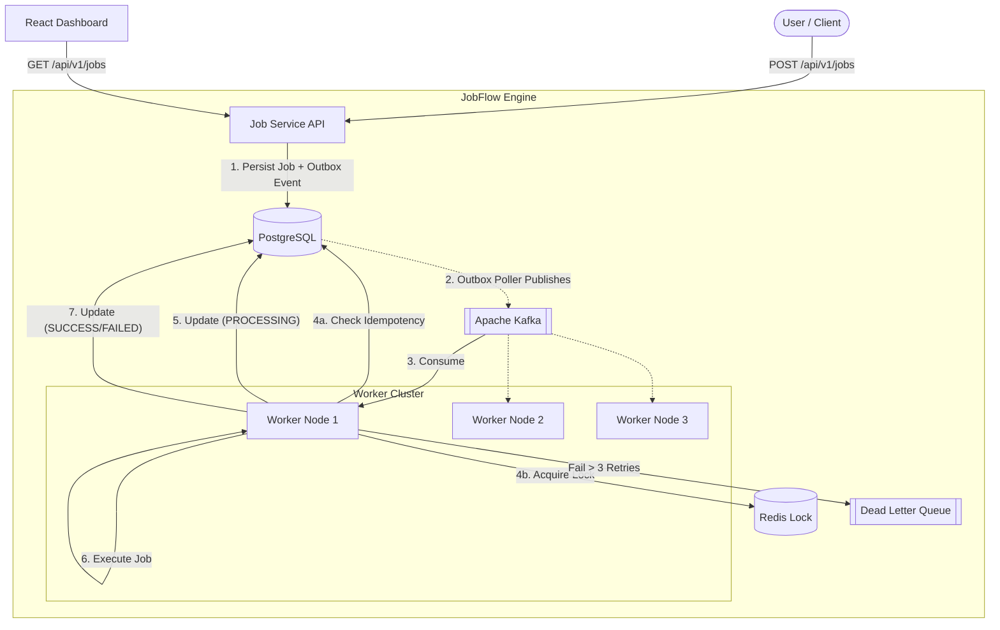

# JobFlow

JobFlow is a distributed, asynchronous job processing engine built with Spring Boot, Kafka, and Redis, designed to execute background tasks reliably.

## 🎯 The Problem
In modern distributed systems, directly processing heavy tasks (like PDF generation, massive report aggregation, or bulk emails) within a synchronous HTTP request blocks the main thread, causing application timeouts and poor user experience. Additionally, simple background threads are volatile — if a node crashes, the task is lost forever.

## 💡 The Solution
JobFlow solves this by decoupling job ingestion from job processing using an event-driven architecture.
1. The **Job Service** quickly persists the job request and acknowledges the user.
2. An event is published to **Kafka**.
3. A cluster of **Job Workers** pull jobs from Kafka and process them safely in the background.

## 🏗️ Architecture



## 🛠️ Tech Stack
- **Backend**: Java 25, Spring Boot 4.1.1
- **Database**: PostgreSQL 15 (State & Idempotency)
- **Message Broker**: Apache Kafka 3.7 (Event streaming)
- **Distributed Cache**: Redis 7 (Distributed locking)
- **Frontend**: React 18, Vite, Lucide Icons
- **Infrastructure**: Docker & Docker Compose

## 📡 API Documentation

### Create Job
`POST /api/v1/jobs`
```json
{
  "type": "PDF_GENERATION",
  "payload": {
    "userId": "123",
    "template": "invoice"
  },
  "maxRetries": 3
}
```

### Get Job Status
`GET /api/v1/jobs/{jobId}`

### Get Dashboard Stats
`GET /api/v1/jobs/stats`

## 🛡️ Reliability Engineering

### 1. Kafka Design
Kafka acts as the central nervous system. By using Consumer Groups, JobFlow naturally load balances tasks across the worker cluster. If a worker goes down, Kafka automatically rebalances the partition to healthy nodes.

### 2. Exponential Backoff Retry Strategy & Durable Retry Outbox
If a job throws an exception, the worker catches it and calculates an exponential backoff (1s -> 2s -> 4s). However, rather than scheduling the retry in volatile JVM memory (which would be lost if the worker crashed), it writes a `scheduled_retries` entry into PostgreSQL transactionally alongside the job's `ERROR` state. A background `ScheduledRetryPublisher` sweeps the database and reliably pushes due retries back to the Kafka topic. This prevents hammering failing third-party APIs while guaranteeing that no retries are ever dropped due to process failure.

### 3. Idempotent Processing
Because Kafka guarantees at-least-once delivery, duplicates can occur (or a failing job can generate new retry messages). We enforce idempotent business logic by leveraging JPA Optimistic Locking (`@Version`) on the job state and atomic state transitions in PostgreSQL. If a duplicate message or concurrent worker attempts to process the same job ID, the database state transition acts as an idempotency lock, safely bouncing duplicate executions and preventing race conditions even when the Redis lock fails. This ensures that regardless of how many messages arrive, the job execution is protected against duplicate state progression.

### 4. Redis Distributed Locking (Redisson)
To prevent edge cases where two workers might receive identical events simultaneously, workers must acquire a distributed lock before processing. We use **Redisson** for this, which provides a mature locking abstraction (`RLock`). Redisson automatically manages lease renewals (the "watchdog" pattern) for long-running jobs and safely ties the lock to the specific worker thread, preventing accidental lock deletions by other workers. If a lock is denied, the worker skips the job.

### 5. Transactional Outbox Pattern
To solve the classic DB-to-Kafka dual-write problem, the Job Service uses the **Transactional Outbox Pattern**. Instead of publishing to Kafka directly after saving to the database (which could strand jobs if the app crashes between the DB commit and Kafka publish), the API transactionally writes an `outbox_event` to the database alongside the job. A background poller then reliably sweeps the outbox and publishes the events to Kafka, guaranteeing at-least-once publishing without data loss.

### 6. Dead Letter Queue (DLQ)
When a job exceeds its `maxRetries`, it is marked as `FAILED` and published to a special `job-dlq` Kafka topic for manual engineering intervention.

### 7. Strategy Pattern for Extensible Task Processing
The worker engine employs the **Strategy Pattern** via a flexible `JobHandler` interface. Instead of hardcoding task logic, developers can create distinct job handlers (`PdfJobHandler`, `EmailJobHandler`, `ReportJobHandler`, etc.) that the worker dynamically selects based on the event payload. 

### 8. Worker Thread Management
Upon receiving a message, the `KafkaJobConsumer` validates the event and submits the actual processing logic (and Redisson locking) to a bounded `ExecutorService` thread pool. This delegates the heavy lifting off the main Kafka polling thread.

## 🚀 How to Run

JobFlow is packaged for zero-configuration startup using Docker Compose.

1. Ensure Docker is running.
2. Spin up the entire infrastructure:
   ```bash
   docker-compose up -d --build
   ```
3. Open the UI to monitor jobs:
   - [http://localhost:5173](http://localhost:5173)
4. Scale workers on the fly:
   ```bash
   docker-compose up -d --scale job-worker=3
   ```

## 🎥 Demo
Check out the fully functional dashboard in action, monitoring 100+ async jobs seamlessly recovering from errors and scaling!


