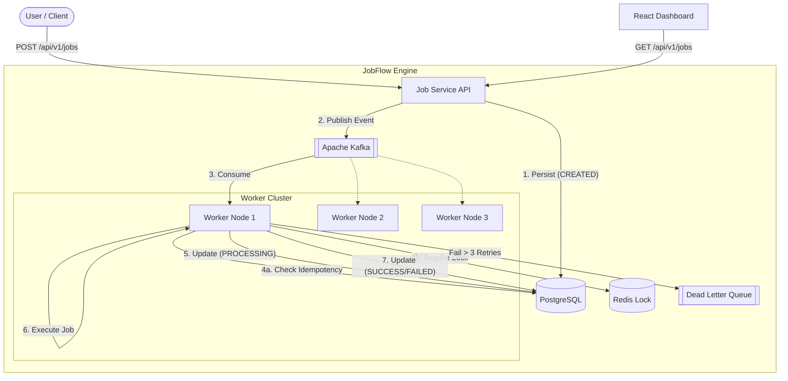

# JobFlow

JobFlow is a robust, distributed, asynchronous job processing engine built with Spring Boot, Kafka, and Redis, designed to safely execute thousands of long-running or resource-intensive tasks.

## 🎯 The Problem
In modern distributed systems, directly processing heavy tasks (like PDF generation, massive report aggregation, or bulk emails) within a synchronous HTTP request blocks the main thread, causing application timeouts and poor user experience. Additionally, simple background threads are volatile — if a node crashes, the task is lost forever.

## 💡 The Solution
JobFlow solves this by decoupling job ingestion from job processing using an event-driven architecture.
1. The **Job Service** quickly persists the job request and acknowledges the user.
2. An event is published to **Kafka**.
3. A cluster of **Job Workers** pull jobs from Kafka and process them safely in the background.

## 🏗️ Architecture



## 🛠️ Tech Stack
- **Backend**: Java 25, Spring Boot 3.4
- **Database**: PostgreSQL 15 (State & Idempotency)
- **Message Broker**: Apache Kafka 3.7 (Event streaming)
- **Distributed Cache**: Redis 7 (Distributed locking)
- **Frontend**: React 18, Vite, Lucide Icons
- **Infrastructure**: Docker & Docker Compose

## 📡 API Documentation

### Create Job
`POST /api/v1/jobs`
```json
{
  "type": "PDF_GENERATION",
  "payload": {
    "userId": "123",
    "template": "invoice"
  },
  "maxRetries": 3
}
```

### Get Job Status
`GET /api/v1/jobs/{jobId}`

### Get Dashboard Stats
`GET /api/v1/jobs/stats`

## 🛡️ Reliability Engineering

### 1. Kafka Design
Kafka acts as the central nervous system. By using Consumer Groups, JobFlow naturally load balances tasks across the worker cluster. If a worker goes down, Kafka automatically rebalances the partition to healthy nodes.

### 2. Exponential Backoff Retry Strategy
If a job throws an exception, the worker catches it and reschedules the job with an exponential backoff (1s -> 2s -> 4s) using an asynchronous, non-blocking `ScheduledExecutorService`. This prevents hammering failing third-party APIs.

### 3. Exactly-Once Idempotency
Because Kafka guarantees at-least-once delivery, duplicates can occur. We track every processed `messageId` in PostgreSQL using a Unique Constraint. If Kafka redelivers a duplicate event, it bounces off the database and is safely ignored.

### 4. Redis Distributed Locking
To prevent edge cases where two workers might receive identical events at the exact same millisecond, workers must acquire a Redis distributed lock (`SETNX` with a 30s TTL) before processing. If denied, the worker skips the job.

### 5. Dead Letter Queue (DLQ)
When a job exceeds its `maxRetries`, it is marked as `FAILED` and published to a special `job-dlq` Kafka topic for manual engineering intervention.

## 🚀 How to Run

JobFlow is packaged for zero-configuration startup using Docker Compose.

1. Ensure Docker is running.
2. Spin up the entire infrastructure:
   ```bash
   docker-compose up -d --build
   ```
3. Open the UI to monitor jobs:
   - [http://localhost:5173](http://localhost:5173)
4. Scale workers on the fly:
   ```bash
   docker-compose up -d --scale job-worker=3
   ```

## 🎥 Demo
Check out the fully functional dashboard in action, monitoring 100+ async jobs seamlessly recovering from errors and scaling!


